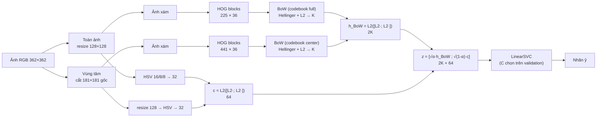
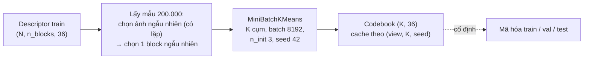
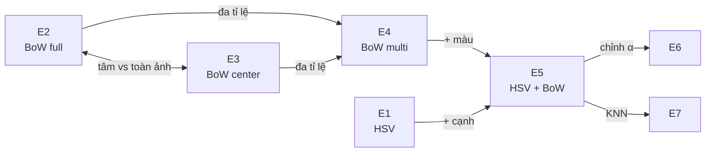
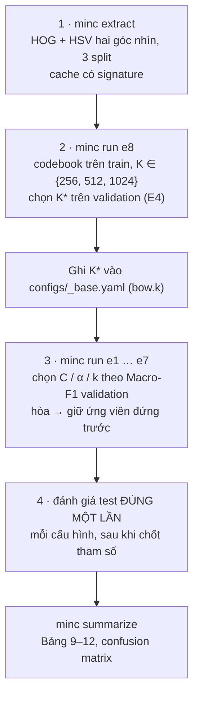

# Luồng xử lý: HSV + BoW-HOG đa tỉ lệ

> Tóm tắt từ báo cáo *"Nghiên cứu kết hợp đặc trưng màu sắc và đặc trưng cạnh đa tỉ lệ trong bài
> toán phân loại chất liệu bề mặt"* (CS231). Số trong ngoặc như (13) là số công thức trong báo cáo.
> Chữ ký hàm: [api.md](api.md). Config: [config-schema.md](config-schema.md).

## 1. Bài toán

- **Dữ liệu:** MINC-2500 Split 1, 23 lớp, ảnh RGB 362 × 362.
  Train 48.875 (2.125 ảnh/lớp), validation 2.875 (125/lớp), test 5.750 (250/lớp).
- **Nhãn theo điểm ở tâm ảnh.** Chất liệu thường chỉ chiếm một phần ảnh, nên biểu diễn cần:
  - mô tả *loại vân* và màu, **không phụ thuộc vị trí** của cạnh hay mảng màu;
  - **chú ý riêng vùng quanh tâm**, nơi có nhãn.
- **Input:** một ảnh RGB. **Output:** một nhãn $\hat y \in \{0, \dots, 22\}$.

## 2. Tổng quan



Năm giai đoạn, ứng với các module:

| # | Giai đoạn | Module |
|---|---|---|
| 1 | Tạo hai góc nhìn | `features/views.py` |
| 2 | Trích descriptor block HOG, không nối theo vị trí | `features/hog.py` |
| 3 | Mã hóa BoW: codebook (chỉ học trên train), Hellinger + L2, ghép hai góc nhìn | `features/bow.py`, `features/fusion.py` |
| 4 | HSV hai góc nhìn, kết hợp có trọng số với khối cạnh | `features/hsv.py`, `features/fusion.py` |
| 5 | Phân loại, chọn tham số theo Macro-F1 trên validation | `models/classifiers.py` |

## 3. Hai góc nhìn của mỗi ảnh

| Góc nhìn | Cách lấy | Kích thước | HOG trên | HSV trên |
|---|---|---|---|---|
| Toàn ảnh | Resize RGB, `INTER_AREA` | 128 × 128 | ảnh xám | ảnh 128 × 128 |
| Vùng tâm | Cắt chính giữa, cạnh $s = \lfloor \min(h, w)/2 \rfloor$ (13) | 181 × 181 | ảnh xám | resize về 128 × 128 |

Toàn ảnh cho ngữ cảnh và vân ở mức thô (thu nhỏ khoảng 2,8 lần). Vùng tâm giữ chi tiết vân
nhỏ tại đúng nơi có nhãn.

## 4. Đặc trưng cạnh: BoW-HOG đa tỉ lệ

### 4.1 Descriptor block HOG

| Tham số | Giá trị |
|---|---|
| Orientations | 9 (không dấu, 0°–180°) |
| Pixels per cell | 8 × 8 |
| Cells per block | 2 × 2, bước 1 cell |
| Chuẩn hóa block | L2-Hys |
| Số chiều mỗi descriptor | 36 |

Số block với ảnh vuông cạnh $n$ (14): $(\lfloor n/8 \rfloor - 1)^2$
→ toàn ảnh **225**, vùng tâm **441** (5 điểm ảnh lẻ ở mép bị bỏ).

Mỗi block là **một descriptor cục bộ**; không nối thành vector dài theo vị trí, vì vector đó phụ
thuộc bố cục ảnh.

### 4.2 Học codebook (chỉ trên train)



- **Mỗi góc nhìn một codebook riêng**, vì phân bố vân ở ảnh thu nhỏ và ở độ phân giải gốc khác nhau.
- Validation và test **không bao giờ** tham gia học codebook.

### 4.3 Mã hóa BoW và chuẩn hóa Hellinger

Gán cứng mỗi descriptor vào từ gần nhất, đếm histogram $n \in \mathbb{N}^K$ (8), rồi (15):

$$p = \frac{n}{\sum_j n_j}, \qquad b = \frac{\sqrt{p}}{\lVert \sqrt{p} \rVert_2}$$

Tích vô hướng giữa hai vector $b$ chính là kernel Hellinger (hệ số Bhattacharyya) giữa hai phân
phối (9). Vì vậy một bộ phân loại tuyến tính trên $b$ tương đương dùng kernel Hellinger, mà vẫn
rẻ như mô hình tuyến tính.

### 4.4 Ghép hai góc nhìn (16)

$$h_{\text{BoW}} = \mathrm{L2}\big([\,\mathrm{L2}(b_{\text{full}});\ \mathrm{L2}(b_{\text{center}})\,]\big) \in \mathbb{R}^{2K}$$

Chuẩn hóa từng khối trước khi nối ⇒ mỗi góc nhìn đóng góp đúng 1/2 bình phương chuẩn, dù vùng
tâm có nhiều descriptor hơn (441 so với 225).

## 5. Đặc trưng màu HSV hai góc nhìn

| Kênh | Miền (OpenCV, 8 bit) | Số bin |
|---|---|---|
| H | 0–179 | 16 |
| S | 0–255 | 8 |
| V | 0–255 | 8 |
| **Tổng mỗi góc nhìn** | | **32** |

Ảnh resize về 128 × 128 → HSV → histogram từng kênh → **chuẩn hóa L1 từng kênh** (3) → nối H, S, V.
Ghép hai góc nhìn giống khối cạnh (17):

$$c = \mathrm{L2}\big([\,\mathrm{L2}(c_{\text{full}});\ \mathrm{L2}(c_{\text{center}})\,]\big) \in \mathbb{R}^{64}$$

## 6. Kết hợp có trọng số (18)–(19)

$$z = \big[\,\sqrt{\alpha}\, h_{\text{BoW}};\ \sqrt{1-\alpha}\, c\,\big] \in \mathbb{R}^{2K + 64}, \qquad \lVert z \rVert_2^2 = \alpha + (1-\alpha) = 1$$

- Khối cạnh đứng trước. Mặc định $\alpha = 0{,}5$.
- $\alpha$ đúng bằng tỉ lệ đóng góp của khối cạnh vào bình phương chuẩn; tích vô hướng giữa hai
  vector $z$ là tổ hợp lồi của độ tương đồng cạnh và màu.

| Khối | Công thức | K = 256 | K = 512 | K = 1024 |
|---|---|---:|---:|---:|
| HSV hai góc nhìn $c$ | 2 × 32 | 64 | 64 | 64 |
| BoW một góc nhìn | K | 256 | 512 | 1.024 |
| BoW đa tỉ lệ $h_{\text{BoW}}$ | 2K | 512 | 1.024 | 2.048 |
| Vector kết hợp $z$ | 2K + 64 | 576 | 1.088 | 2.112 |

## 7. Bộ phân loại

| Thành phần | Thiết lập |
|---|---|
| LinearSVC — C | 0,01; 0,1; 1; 10 |
| LinearSVC — penalty / loss | L2 / squared hinge (one-vs-rest) |
| LinearSVC — max_iter / tol / seed | 5000 / 1e-4 / 42 |
| KNN — số láng giềng k | 3; 5; 7; 9 |
| KNN — weights / metric | uniform / euclidean |

Ký hiệu: **K** là kích thước codebook, **k** là số láng giềng của KNN — hai đại lượng khác nhau.

## 8. Bộ thí nghiệm

| Mã | Biểu diễn | Variant trong config | Bộ phân loại | Số chiều | Chọn trên validation |
|---|---|---|---|---:|---|
| E1 | HSV toàn ảnh + tâm $c$ | `hsv` | LinearSVC | 64 | C |
| E2 | BoW HOG-128 toàn ảnh | `bow_full` | LinearSVC | K\* | C |
| E3 | BoW HOG vùng tâm gốc | `bow_center` | LinearSVC | K\* | C |
| E4 | BoW đa tỉ lệ $h_{\text{BoW}}$ | `bow_multi` | LinearSVC | 2K\* | C |
| **E5** | **HSV + BoW đa tỉ lệ, α = 0,5 (phương án chính)** | `hsv_bow_multi` | LinearSVC | 2K\* + 64 | C |
| E6 | Như E5, α ∈ {0,25; 0,5; 0,75} | `hsv_bow_multi` | LinearSVC | 2K\* + 64 | α, C |
| E7 | Như E5 | `hsv_bow_multi` | KNN | 2K\* + 64 | k |
| E8 | Khảo sát K ∈ {256, 512, 1024} với E4 và E5 | — | LinearSVC | — | **K\*** theo E4 |

**E8:** K\* chọn theo Macro-F1 validation của **E4**, vì K là thuộc tính của codebook HOG, không
nên phụ thuộc vào màu hay α. Hòa thì giữ K nhỏ hơn.

### Cặp ablation



| So sánh | Câu hỏi |
|---|---|
| E2 – E3 | Vùng tâm ở độ phân giải gốc có tốt hơn toàn ảnh không |
| E2 – E4, E3 – E4 | Đa tỉ lệ có tốt hơn từng góc nhìn riêng không |
| E1 – E5, E4 – E5 | Màu và cạnh có bổ trợ nhau không |
| E5 – E6 | Có cần chỉnh α không |
| E5 – E7 | LinearSVC hay KNN |
| E8 | Độ nhạy theo K |

$\Delta = \text{điểm}(B) - \text{điểm}(A)$ trên test (23). Cặp đa tỉ lệ và cặp thêm màu **đồng thời
đổi số chiều** — phải nêu rõ khi phân tích. Nếu E6 tốt hơn E5 rõ rệt, vẫn giữ E5 làm phương án
chính (đơn giản, không thêm siêu tham số); E6 là ablation.

## 9. Quy trình chọn tham số và đánh giá



**Điều tuyệt đối tránh**

- Dùng test cho bất kỳ lựa chọn nào: K, C, α hay k.
- Học codebook trên validation hoặc test.

**Mỗi lần chạy ghi lại** (`runs/<tên>/metadata.json`): commit Git, revision dataset, cache
signature, seed, K, hash codebook, α và tham số đã chọn, thời gian từng bước, phiên bản thư viện,
thông tin máy.

## 10. Độ đo

- **Accuracy** và **Macro-F1** trên đủ 23 lớp; Macro-F1 là trung bình F1 không trọng số (21).
- **Precision / Recall / F1 từng lớp** (20); lớp không có dự đoán đúng nào có F1 = 0.
- **Confusion matrix** $M_{ij}$ = số mẫu nhãn thật $i$ bị dự đoán là $j$ (22); khi vẽ, chuẩn hóa
  theo hàng (chia 250) để đọc trực tiếp Recall.
- Test cân bằng hoàn toàn ⇒ Accuracy = trung bình Recall của 23 lớp.

## 11. Chi phí ước tính

| Hạng mục | Ước tính |
|---|---|
| Cache descriptor train vùng tâm (float16) | 48.875 × 441 × 36 × 2 B ≈ 1,55 GB |
| Cache descriptor train toàn ảnh | ≈ 0,8 GB |
| Validation + test | thêm ≈ 15% → tổng ≈ 2,8 GB |
| Fit LinearSVC | 10–50 s mỗi giá trị C khi K ≤ 512; K = 1024 chưa đo |
| Ma trận đặc trưng lớn nhất | 48.875 × 2.112 float64 ≈ 0,8 GB RAM |

## 12. File sinh ra trên đĩa

```
<CACHE_ROOT>/
  hog-full-<split>-<sig>.npy      (N, 225, 36) float16
  hog-center-<split>-<sig>.npy    (N, 441, 36) float16
  hsv-full-<split>-<sig>.npy      (N, 32) float32
  hsv-center-<split>-<sig>.npy    (N, 32) float32
  labels-<split>-<sig>.npy        (N,) int64
  codebook-<view>-k<K>-<sig>.npy  (K, 36) float32
<RUNS_ROOT>/<experiment.name>/
  metadata.json  selection.json  metrics_test.json  confusion_test.png   # E1–E7
  metadata.json  survey.json                                              # E8
```
