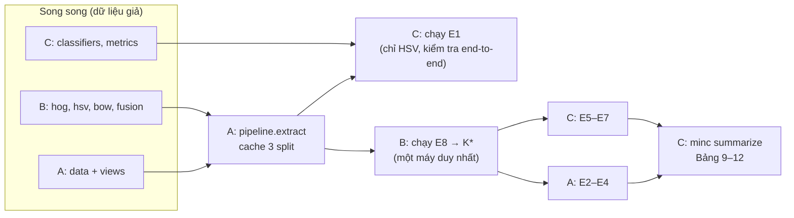

# Chia việc và quy trình làm việc

## Vai trò

| Vai | Phụ trách code | Phần báo cáo |
|---|---|---|
| **A — hạ tầng và tích hợp** | `data/`, `features/views.py`, `pipeline.py` (extract, codebook cache, chạy E1–E8, khoá test một lần) | IV.1 (dữ liệu, môi trường, quy trình) |
| **B — đặc trưng** | `features/hog.py`, `features/hsv.py`, `features/bow.py`, `features/fusion.py` | Chương III (phương pháp) |
| **C — phân loại và đánh giá** | `models/classifiers.py`, `evaluation/metrics.py`, `evaluation/report.py`, notebook vẽ hình | IV.2–IV.5 (kết quả, ablation, phân tích lớp) |

Đề xuất: trưởng nhóm giữ vai A vì A là người tích hợp và nắm toàn bộ pipeline. Hạ tầng chung
(`config.py`, `repro.py`, `cache.py`, `cli.py`) đã viết sẵn; ai sửa thì báo A review.

## Thứ tự công việc



- **E8 chạy trên một máy duy nhất**, vì Bảng 9 có cột thời gian (codebook / mã hóa / fit) và chỉ so
  sánh được khi đo cùng máy.
- Các thí nghiệm khác chạy máy nào cũng được, vì `metadata.json` ghi đủ commit, phiên bản thư viện
  và thông tin máy.

## Quy trình Git

- Nhánh `main` luôn qua được `uv run pytest`. Mỗi người làm trên `feat/<module>`, ví dụ `feat/bow`.
- Mỗi PR cần một người khác review. Trước khi mở PR:

  ```powershell
  uv run ruff format
  uv run ruff check --fix
  uv run pytest
  ```

- Đổi chữ ký hàm ⇒ PR riêng sửa [api.md](api.md) trước.
- Thêm thư viện: `uv add <gói>` (hoặc `uv add --dev <gói>`), commit cả `pyproject.toml` và `uv.lock`
  trong cùng PR. Không dùng `pip install`.
- Không commit `data/`, `cache/`, `runs/`, `.env`.

Tiến độ chung theo dõi trong [todo.md](todo.md).

## Định nghĩa "xong" cho một module

1. Không còn `todo(...)` trong module.
2. Test hợp đồng của module chuyển từ SKIPPED sang PASSED (`uv run pytest -ra` liệt kê phần còn skip).
3. Có thêm test cho trường hợp riêng nếu cần.
4. Đã được review và merge vào `main`.
